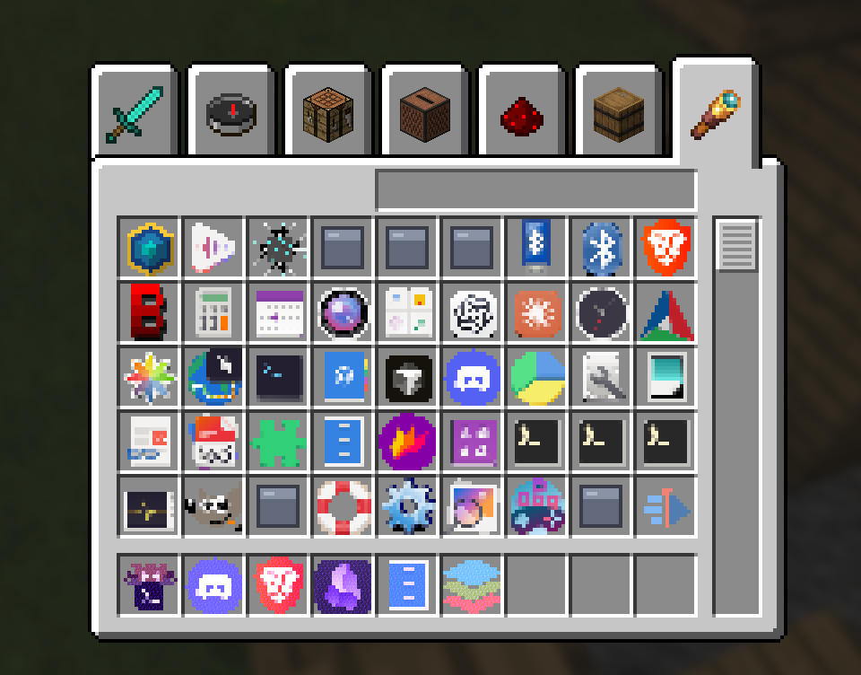

# MCShell

A Linux desktop that uses Minecraft as its shell. The hotbar is your taskbar,
the creative inventory is your app launcher, chat is a command line, and the
pause menu has your settings, files and power options. Apps run as normal
windows on top of the game, managed by Sway.



Not an official Minecraft product. Not approved by or associated with Mojang
or Microsoft.

## Requirements

- Arch Linux
- A Microsoft account that owns Minecraft: Java Edition
- One monitor
- An Intel or AMD GPU (Nvidia's proprietary driver works but isn't supported by Sway)
- A login screen that shows Wayland sessions (tested with GDM)

MCShell is added as an extra session on your login screen. Your current
desktop is still there if you want to go back.

**In a VM** (tested with VMware Workstation):

- Turn on 3D acceleration in the VM's display settings. Without it, MCShell
  sends you back to the login screen.
- In VMware, set Edit → Preferences → Input → *Optimize mouse for games* to
  **Always**. Otherwise the camera lags and jumps.
- MCShell draws in software on VMware's graphics, so expect it to be slower.

## Install

**1. Install packages**

Required:

```bash
sudo pacman -S --needed git sway swaybg swaylock hyprlock polkit-gnome foot python python-gobject gtk4 gtk4-layer-shell uv curl zstd prismlauncher jdk21-openjdk
```

Recommended (sound, network, screenshots, media keys and so on):

```bash
sudo pacman -S --needed pipewire pipewire-pulse wireplumber networkmanager bluez-utils grim wl-clipboard libnotify brightnessctl playerctl socat wlr-randr librsvg imagemagick pciutils zenity xdg-desktop-portal xdg-desktop-portal-gtk
```

**2. Clone the repo**

```bash
git clone https://github.com/novaa1351/mcshell.git ~/mcshell
cd ~/mcshell
```

**3. Set up the daemon**

```bash
(cd daemon && uv venv && uv pip install -e .)
```

**4. Set up the game**

```bash
bin/mcshell setup
```

This builds the mod and creates a Prism Launcher instance called `MCShell`
with three worlds. The first run takes a few minutes. It's done when it
prints `instance ready`.

**5. Sign in to Minecraft**

Open Prism Launcher, add your Microsoft account when it asks, then close
Prism.

**6. Install the session**

```bash
session/install-session.sh
```

This asks for your password to add MCShell to the login screen.

**7. Check everything**

```bash
bin/mcshell check
```

The last line should say `Ready.` Anything marked `MISSING` tells you what to
run.

**8. Log in**

Log out. On the login screen, pick MCShell (on GDM: click your user, then the
gear icon in the bottom right) and log in. You'll load into Tutorial World.

## Controls

| Key | Does |
|---|---|
| Super | Back to the game |
| E, then the chest tab | App catalog. Click an app, then a hotbar slot to keep it |
| Right-click (app in hand) | Open or focus it |
| Left-click (app in hand) | Cycle its windows |
| Shift + right-click | Open a new window of it |
| T | Command line: `firefox &` starts a program |
| Esc | Settings (Options), system info (Statistics), files (Advancements), worlds, and power (Save and Quit) |
| F2 | Screenshot |

These work even if the game or the daemon has crashed:

| Key | Does |
|---|---|
| Super + Shift + Return | Terminal |
| Super + Shift + M | Restart the game |
| Super + Shift + D | Restart the daemon |
| Super + Shift + L | Lock |
| Alt + F4 | Close the focused window |
| Super + Shift + E | Log out |

To use a terminal other than foot, put `TERMINAL=kitty` (or yours) in
`~/.config/environment.d/50-terminal.conf` and log in again.

## Troubleshooting

- `mcshell check` shows what's missing. Run it from any terminal.
- `mcshell diagnose` shows what a running session sees. Run it inside MCShell.
- Logs: `journalctl --user -u mcshelld -u mcshell-client` and
  `~/.local/state/mcshell/session.log`
- If MCShell won't start, pick your normal desktop on the login screen.

More symptoms and fixes: [docs/troubleshooting.md](docs/troubleshooting.md).
Include the output of `mcshell check` in bug reports.

## Uninstall

```bash
sudo rm /usr/share/wayland-sessions/mcshell.desktop
rm ~/.config/systemd/user/mcshelld.service ~/.config/systemd/user/mcshell-client.service ~/.config/systemd/user/mcshell-session.target
systemctl --user daemon-reload
rm -rf ~/.config/mcshell ~/.local/state/mcshell ~/.cache/mcshell ~/.config/sway/config.d/mcshell-*.conf
```

Your worlds are in the Prism instance at
`~/.local/share/PrismLauncher/instances/MCShell`. Delete it from Prism if you
don't want them.

## License

MIT. See [LICENSE](LICENSE). No Minecraft assets are included; the shell reads
them from your own copy of the game.
